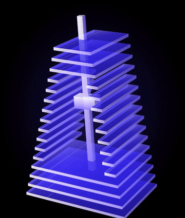
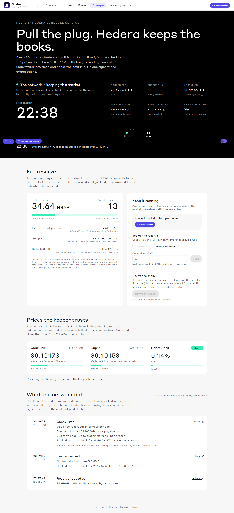
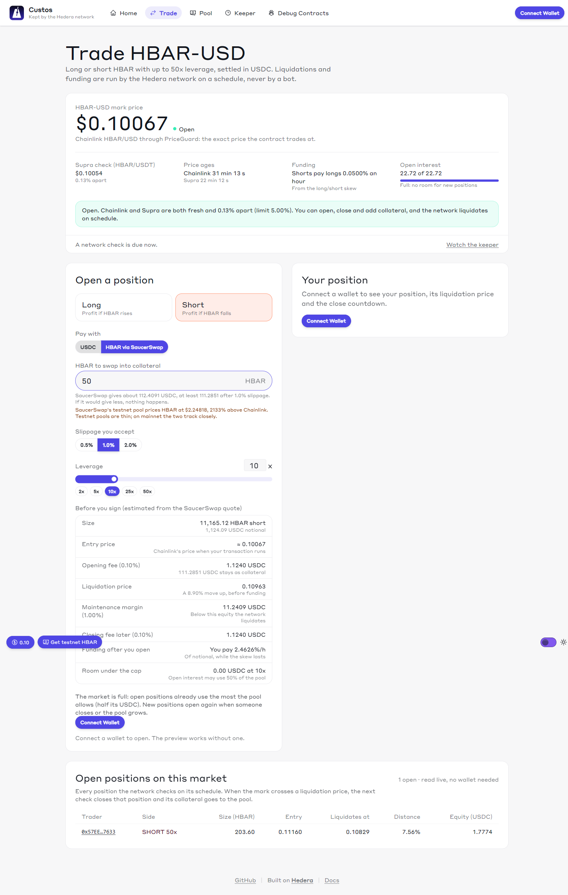
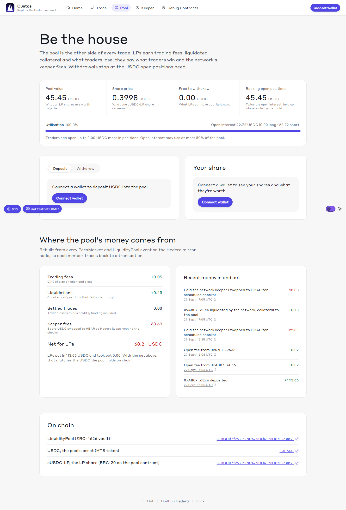
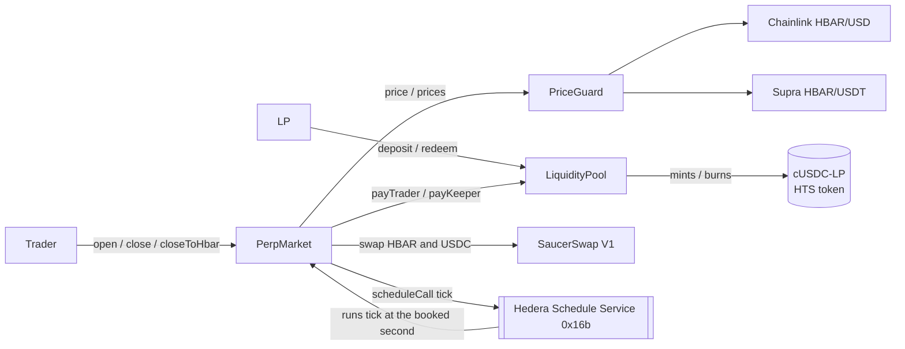
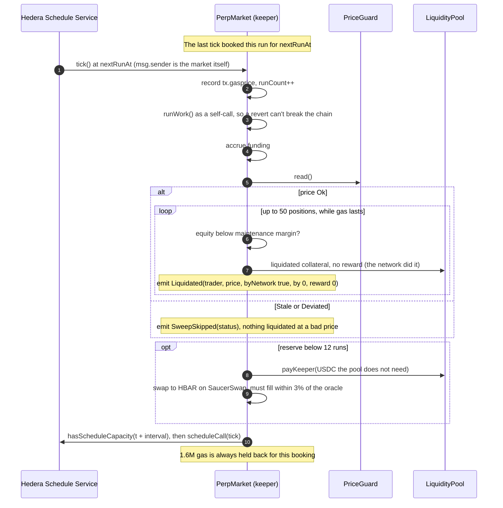

<div align="center">

# Custos

**A margin engine the Hedera network keeps.**

[](https://github.com/victorjayeoba/scaffold-hbar-custos/actions/workflows/lint.yaml)
[](https://github.com/victorjayeoba/scaffold-hbar-custos/actions/workflows/fresh-scaffold.yaml)
[](https://github.com/victorjayeoba/scaffold-hbar-custos/actions/workflows/e2e.yaml)
[](https://github.com/victorjayeoba/scaffold-hbar-custos/actions/workflows/gitleaks.yaml)
[](https://github.com/victorjayeoba/scaffold-hbar-custos/actions/workflows/docs.yaml)
[](LICENSE)




```bash
npm create scaffold-hbar@latest --template victorjayeoba/scaffold-hbar-custos
```

</div>

Custos (Latin: *the keeper*) is a [Scaffold-HBAR](https://docs.hedera.com/solutions/tools/scaffold-hbar/index) template for leveraged positions that **no bot has to watch**. Every 30 minutes the Hedera Schedule Service calls the market by itself (HIP-1215). The market charges funding, liquidates underwater positions at a price Chainlink and Supra agree on, and **books its own next run**, paid from its own HBAR. Nobody signs those transactions.

The demo is an HBAR-USD perpetual market settled in USDC, backed by a USDC pool whose LP shares are a native HTS token. The template is the three contracts underneath it, which you can reuse for lending, expiries, payouts or any job that must run on a timer.

**Contents:** [Judge it in 90 seconds](#judge-it-in-90-seconds) · [What you get](#what-you-get) · [How it works](#how-it-works) · [Proof on testnet](#proof-on-testnet) · [Quick start](#quick-start) · [HIP-1215, learned the hard way](#hip-1215-learned-the-hard-way) · [Costs](#what-a-tick-costs) · [Units and numbers](#units-and-numbers) · [Configuration](#configuration) · [Troubleshooting](#troubleshooting) · [Testing and CI](#testing-and-ci) · [Honest limits](#honest-limits) · [Extending it](#extending-it) · [Project structure](#project-structure)

## Judge it in 90 seconds

Each link opens on HashScan. Nothing here needs a wallet.

| # | Click | What you'll see |
| --- | --- | --- |
| 1 | [Tick 4 of the final deploy](https://hashscan.io/testnet/transaction/0x7c37d2a7399f66bc85fe549a12766212d8622ed0a31911959c204e588dde59a9) | **A liquidation nobody signed.** A `CONTRACTCALL` the Schedule Service executed from a booked schedule (the mirror node reports `scheduled: true`, `SUCCESS`). HBAR rose to $0.10277, past the 50x short's liquidation price, and the market liquidated it with `Liquidated(byNetwork = true, by = 0x0, reward = 0)`: all its collateral to the pool, no reward because no one called it. The market paid 1.980 ℏ for 2,385,537 gas. |
| 2 | [Schedule 0.0.10834054](https://hashscan.io/testnet/schedule/0.0.10834054) | The schedule that ran tick 4. The market booked it during tick 3 and is its payer: the contract books and pays for its own next run. |
| 3 | [Tick 1 of the final deploy](https://hashscan.io/testnet/transaction/0x5bebf1d891890489514a052be62988357a00dc621b9fa19a6fe09f80de0038f6) | The first network run, from [schedule 0.0.10833097](https://hashscan.io/testnet/schedule/0.0.10833097): accrued funding, swept the 2 open positions, recorded the gas price it ran at (84 tinybar/gas) and booked tick 2. 1.359 ℏ for 1,618,265 gas. |
| 4 | [Heartbeat 0.0.10776628](https://hashscan.io/testnet/contract/0.0.10776628) | The smallest keeper ticking three times, 60 s apart, each run booked by the run before it ([1](https://hashscan.io/testnet/schedule/0.0.10776630), [2](https://hashscan.io/testnet/schedule/0.0.10776638), [3](https://hashscan.io/testnet/schedule/0.0.10776648)). |
| 5 | [cUSDC-LP 0.0.10833090](https://hashscan.io/testnet/token/0.0.10833090) | The LP share: a native HTS token the pool contract created and mints, not an ERC-20 imitation. |
| 6 | [Open with HBAR alone](https://hashscan.io/testnet/transaction/0x62868b097e839fdeeef472c7fd8ff26f58a3ddd410924b825f2855d75e3986e7) | A 50x long opened with 1 ℏ, swapped to USDC collateral on SaucerSwap in the same transaction. |

Then run the app (`yarn next:dev`) and open `/keeper`: the countdown to the next network run, the fee reserve, both oracle feeds, and every run the network executed, read from the mirror node.

## What you get

### Three reusable contracts, and a market built from them

| Contract | Job | Reuse it for |
| --- | --- | --- |
| [`ScheduledKeeper`](packages/foundry/contracts/ScheduledKeeper.sol) (abstract) | Runs `_work()` every `interval` seconds with no bot. Each `tick()` books the next one on the Schedule Service and pays for it from the contract's own HBAR. Probes capacity, holds gas back for the booking, survives a failing job, and can be revived by anyone. | Liquidations, interest, expiries, rebalancing, payouts |
| [`PriceGuard`](packages/foundry/contracts/PriceGuard.sol) | Chainlink is the price, Supra is the cross-check. `Stale` if either feed is older than `maxStaleness`, `Deviated` if they differ by more than `maxDeviationBps`. Never reverts on a broken feed. | Anything that must refuse to act on a bad price |
| [`MarginAccount`](packages/foundry/contracts/MarginAccount.sol) (abstract) | Position book and risk math: PnL, funding, equity, maintenance margin, liquidation price, and running sums that value every open position in O(1). | Perps, margin, anything with leveraged positions |
| [`PerpMarket`](packages/foundry/contracts/PerpMarket.sol) | The demo: HBAR-USD perpetual settled in USDC. Inherits all three. The network liquidates and charges funding on every tick. | Copy it for a new market |
| [`LiquidityPool`](packages/foundry/contracts/LiquidityPool.sol) | USDC in, cUSDC-LP out: an HTS token the pool creates and mints. Every trader's counterparty. | Any vault whose shares should be a real Hedera token |
| [`Heartbeat`](packages/foundry/contracts/examples/Heartbeat.sol) | The smallest keeper: counts its own beats. | Start here for your own keeper |

### Four pages on top of Scaffold-HBAR

| Page | What it does |
| --- | --- |
| `/` | What Custos is, the live Chainlink and Supra readout, and the testnet proof. |
| `/trade` | Open long or short with USDC or with HBAR alone (SaucerSwap swaps it), 1–50x. See your liquidation price, add collateral, close to USDC or straight to HBAR. Every open position is listed with its liquidation price. |
| `/pool` | Deposit USDC for cUSDC-LP, redeem or withdraw, share price, what the pool has earned (fees, liquidations, trader losses, keeper costs). Handles HTS association for you. |
| `/keeper` | The keeper's heartbeat: countdown to the next run, runs left in the reserve, `fund()` and `revive()` buttons, the price the keeper trusts, and every run the network executed with its fee and a HashScan link. |

Plus the stock `/debug` (every contract function) and `/blockexplorer`.

<table>
  <tr>
    <td width="33%" valign="top"><br><b>/keeper.</b> Every row marked as executed by the network was signed by nobody.</td>
    <td width="33%" valign="top"><br><b>/trade.</b> Open with USDC or HBAR, see the liquidation price before you sign.</td>
    <td width="33%" valign="top"><br><b>/pool.</b> Be the house: the pool takes the other side of every trade.</td>
  </tr>
</table>

Mobile layouts: [keeper](docs/images/keeper-mobile.png) · [trade](docs/images/trade-mobile.png) · [pool](docs/images/pool-mobile.png).

### Hedera services and ecosystem

| Service | How Custos uses it | Load-bearing? |
| --- | --- | --- |
| **Schedule Service (HIP-1215)**, `0x16b` | `scheduleCall` books each next `tick()`; `hasScheduleCapacity` probes up to 10 seconds. The contract is the schedule's payer. | Yes: it is the keeper |
| **Token Service (HTS)**, `0x167` | The pool calls `createFungibleToken`, `mintToken`, `burnToken`, `transferToken` for cUSDC-LP. USDC collateral is HTS token 0.0.5449. HIP-719 `associate()` on token facades. | Yes |
| **Smart contracts** | Solidity, Foundry, deployed with `forge create` / `cast send` through the JSON-RPC relay. | Yes |
| **Mirror node** | The `/keeper` and `/pool` histories (logs plus which transactions were `scheduled`), HTS association status. | For the app |
| **Chainlink** HBAR/USD | The price for every open, close, liquidation and refuel. | Yes |
| **Supra** HBAR/USDT (pair 75) | The cross-check. If it is stale or more than 5% from Chainlink, nothing opens and nothing is liquidated. | Yes: no Supra, no `Ok` price |
| **SaucerSwap V1** | `openWithHbar`, `closeToHbar`, and the keeper's refuel (USDC from the pool to HBAR). | No: optional. Deploy with a zero router and the USDC paths work alone. |

## How it works



- **Collateral sits in the market; the pool backs every position.** On close the market pays the collateral back and the pool covers any profit above it, or keeps any loss. On liquidation the collateral goes to the pool, minus a 0.5% reward if a person liquidated (none if the network did).
- **The pool is priced at what it's really worth:** its USDC minus what traders are up on open positions (or plus what they're down). Without this, anyone could deposit just before a loss lands in the pool and withdraw just after.
- **Open interest is capped at 50% of the pool**, and LPs can't withdraw below twice the open interest, so the pool can always pay every position's largest possible gain (each gain is capped at the position's entry notional).
- **When prices are bad the market is close-only**, and a close settles at whichever feed is worse for the trader.

### A liquidation, end to end



## Proof on testnet

All of it is in [`packages/foundry/TESTNET.md`](packages/foundry/TESTNET.md); addresses are in [`deployments/296.json`](packages/foundry/deployments/296.json).

### Final deployment (2026-10-02)

| Contract | Hedera ID | EVM address |
| --- | --- | --- |
| PerpMarket (keeper) | [0.0.10833087](https://hashscan.io/testnet/contract/0.0.10833087) | `0xb79Cc40A4b1d3C135f71Ed6dc4e9a231cC369b67` |
| LiquidityPool | [0.0.10833082](https://hashscan.io/testnet/contract/0.0.10833082) | `0x06061a60D2f9E99410F1D2b310DCF51A1ff2A3b1` |
| PriceGuard | [0.0.10833074](https://hashscan.io/testnet/contract/0.0.10833074) | `0x293e90142cc9dDF603d9Ab405B43236e8077EF75` |
| cUSDC-LP (HTS, created by the pool) | [0.0.10833090](https://hashscan.io/testnet/token/0.0.10833090) | `0x0000000000000000000000000000000000a54cc2` |
| USDC (SaucerSwap testnet's) | 0.0.5449 | `0x0000000000000000000000000000000000001549` |

### Every flow, on chain

| Flow | Transaction |
| --- | --- |
| Pool creates its HTS share token (cUSDC-LP) | [`0xf405eade…340a5a`](https://hashscan.io/testnet/transaction/0xf405eadedf1ddd1e99b615a619ae451d0f5b78dd049fb8bfb84189e681340a5a) |
| Keeper books its first tick (`revive`) | [`0xa1b7d249…fa1b71`](https://hashscan.io/testnet/transaction/0xa1b7d249013f1f2812b4176ccc234f54fc0a2f0dc48270cd7f2bdd26e8fa1b71), schedule [0.0.10833097](https://hashscan.io/testnet/schedule/0.0.10833097) |
| Deposit 361.79 USDC, pool mints cUSDC-LP | [`0x55d081b2…54d722`](https://hashscan.io/testnet/transaction/0x55d081b26535e7c9ef68664a080f0609a7caacab03becc115ee7180e1154d722) |
| Open with HBAR: 50x long, 1 ℏ swapped to USDC on SaucerSwap | [`0x62868b09…3986e7`](https://hashscan.io/testnet/transaction/0x62868b097e839fdeeef472c7fd8ff26f58a3ddd410924b825f2855d75e3986e7) |
| Open with USDC: 50x short, 1.2 USDC | [`0xfac6b7ec…7bdba`](https://hashscan.io/testnet/transaction/0xfac6b7ecccee1f124fd9eb56be2f9657a8457dee24ccef923c2f434abbb7bdba) |
| Open with USDC: 2x long, 1 USDC | [`0xd3f325cf…443de8`](https://hashscan.io/testnet/transaction/0xd3f325cf8191e5e197b9af1f45a9ab90173079181724f9f331bb603726443de8) |
| Close, paid out in USDC | [`0xbaa65216…c61df6`](https://hashscan.io/testnet/transaction/0xbaa65216cdb2988c3164ae25193927e622255133d6866d3c46605d6f83c61df6) |
| Close straight to HBAR (`closeToHbar`, payout swapped on SaucerSwap) | [`0x1e427e54…d91c36`](https://hashscan.io/testnet/transaction/0x1e427e54abd7594d815afa933b1dbacb31ec45ca6f5133f9b416801117d91c36) |
| Redeem 10 cUSDC-LP, pool burns the shares | [`0x90487242…2d7422`](https://hashscan.io/testnet/transaction/0x9048724259694f86a20fa69aa069a89d3e85045703b0a6f1a9b302d66c2d7422) |

### The network keeps the market (final deploy)

Each tick is executed by the Schedule Service from a schedule the previous tick booked; `msg.sender` is the market itself, and no one signs it.

| Tick | Executed | What it did |
| --- | --- | --- |
| 1 | [`0x5bebf1d8…0038f6`](https://hashscan.io/testnet/transaction/0x5bebf1d891890489514a052be62988357a00dc621b9fa19a6fe09f80de0038f6) (schedule [0.0.10833097](https://hashscan.io/testnet/schedule/0.0.10833097)) | Accrued funding, swept the 2 open positions (none underwater), recorded 84 tinybar/gas, booked tick 2. Paid by the market itself: 1.359 ℏ for 1,618,265 gas of 3,000,000 |
| 2 | [`0x756e4e8e…8c518a`](https://hashscan.io/testnet/transaction/0x756e4e8e11bf69370a543a2d518e905c868aca2361ba606455b803140a8c518a) | Funding, sweep (none underwater), booked tick 3. 1.327 ℏ for 1,580,037 gas |
| 3 | [`0xcaaa44b5…0e38aef3`](https://hashscan.io/testnet/transaction/0xcaaa44b5a61366f099f2d334c571e1d578b198357ea07dc56c350c980e38aef3) | Funding, sweep (none underwater), booked tick 4 on schedule [0.0.10834054](https://hashscan.io/testnet/schedule/0.0.10834054). 1.315 ℏ for 1,584,087 gas |
| 4 | [`0x7c37d2a7…8dde59a9`](https://hashscan.io/testnet/transaction/0x7c37d2a7399f66bc85fe549a12766212d8622ed0a31911959c204e588dde59a9) | **Liquidated** the 50x short `0xebBA…F393` at $0.10277 (its liquidation price was $0.10266): `Liquidated(byNetwork = true, by = 0x0, reward = 0)`, all collateral to the pool. Nobody signed it. 1.980 ℏ for 2,385,537 gas |

Later ticks appear live on `/keeper`.

### Earlier deploy (2026-09-29): the first network-run liquidation

The first version (PerpMarket [0.0.10776702](https://hashscan.io/testnet/contract/0.0.10776702), since retired) had the network liquidate a position three days earlier, on the same design before the gas-hold fix. Each tick was executed by the Schedule Service from a schedule the previous tick booked.

| Tick | Schedule | Executed | What it did |
| --- | --- | --- | --- |
| 1 | [0.0.10776713](https://hashscan.io/testnet/schedule/0.0.10776713) | [1790687748.000592261](https://hashscan.io/testnet/transaction/1790687748.000592261) | Funding accrued, swept 2 traders, none underwater |
| 2 | [0.0.10777055](https://hashscan.io/testnet/schedule/0.0.10777055) | [1790689547.018645425](https://hashscan.io/testnet/transaction/1790689547.018645425) | Swept 2 traders, none underwater yet |
| 3 | [0.0.10777398](https://hashscan.io/testnet/schedule/0.0.10777398) | [1790691346.057913123](https://hashscan.io/testnet/transaction/1790691346.057913123) | **Liquidated** the 50x long `0xA807…6Ec6` at 0.11304294 (liquidation price 0.11353): `Liquidated(byNetwork = true, reward = 0)`, all 0.1425 USDC collateral to the pool. 1.755 ℏ for 1.61M gas used of 2.5M |

Tick 3 ran one second before its `nextRunAt`, which the 5 s tolerance absorbs. That deploy's chain later stopped with `INSUFFICIENT_PAYER_BALANCE`, which taught item 2 below; the final deploy is built around it.

### The keeper books itself (Heartbeat)

| Tick | Schedule | Executed | Paid by the contract |
| --- | --- | --- | --- |
| 1 | [0.0.10776630](https://hashscan.io/testnet/schedule/0.0.10776630) | [1790685471.038694104](https://hashscan.io/testnet/transaction/1790685471.038694104) | 1.663 ℏ (includes booking tick 2) |
| 2 | [0.0.10776638](https://hashscan.io/testnet/schedule/0.0.10776638) | [1790685529.003290433](https://hashscan.io/testnet/transaction/1790685529.003290433) | 1.607 ℏ (includes booking tick 3) |
| 3 | [0.0.10776648](https://hashscan.io/testnet/schedule/0.0.10776648) | [1790685588.032277208](https://hashscan.io/testnet/transaction/1790685588.032277208) | 0.066 ℏ (last beat, books nothing) |

### Probes: throwaway contracts that answered a question

| Question | Answer |
| --- | --- |
| Who is `msg.sender` when the Schedule Service runs a booked call? | The contract itself, and `tx.origin` too (`0xd603925b9c9F91ce5D4b48C55834a46730a6143b`) |
| What is `tx.gasprice` inside a scheduled run? | 82 tinybars per gas (`0x2B8ac8aC37764617b96D940141A6f8f5f19b6d8e`) |
| Does Hedera hold the whole gas limit before a scheduled run? | Yes: a 5M-gas run with 3.6 ℏ in the contract failed `INSUFFICIENT_PAYER_BALANCE`, schedule [0.0.10832561](https://hashscan.io/testnet/schedule/0.0.10832561). The failed attempt still cost 0.018 ℏ. |

## Quick start

**You need:** Node.js ≥ 20.18.3, Git, [Foundry](https://getfoundry.sh) (`forge` and `cast`), and for the testnet steps a Hedera testnet account funded from the [faucet](https://portal.hedera.com/faucet).

### 1. Scaffold and test locally (no account, nothing spent)

```bash
npm create scaffold-hbar@latest --template victorjayeoba/scaffold-hbar-custos
cd <your-project>
yarn foundry:compile
yarn foundry:test          # 213 tests, including the 10-invariant solvency suite
```

The Schedule Service only exists on Hedera, not on Anvil or a fork, so the tests use a mock Schedule Service and a mock Token Service. The live keeper runs on testnet.

### 2. Run your own market on testnet

```bash
yarn foundry:account:generate      # or: yarn foundry:account:import
yarn custos:deploy:testnet         # PriceGuard, LiquidityPool, PerpMarket; links them, creates cUSDC-LP, funds the keeper
yarn custos:start:testnet          # associates pool and market with USDC, books the first tick: from here the network runs it
yarn custos:demo:testnet           # optional: seeds the pool via SaucerSwap, opens a 50x long with 1 HBAR
```

- **Signer:** `--keystore <name>` or `ETH_KEYSTORE_ACCOUNT` (otherwise it asks which keystore), or `DEPLOYER_PRIVATE_KEY` in the shell. Never write a key into a file.
- **HBAR it sends by default:** 40 ℏ to the keeper's reserve (`KEEPER_FUND`) and 30 ℏ to create the share token (`SHARE_TOKEN_FEE`; about 12 ℏ is used, the rest comes back). The demo swaps 120 ℏ for pool USDC (`DEMO_POOL_HBAR`) and trades 1 ℏ (`DEMO_TRADE_HBAR`). Gas comes on top.
- `custos:deploy:testnet` writes `packages/foundry/deployments/296.json` and regenerates `packages/nextjs/contracts/deployedContracts.ts`, so the app points at your market.
- Why `forge create` and `cast send` rather than `forge script`: see [item 12](#hip-1215-learned-the-hard-way).

### 3. Run the app

```bash
yarn next:dev
```

Open [localhost:3000/keeper](http://localhost:3000/keeper). The first network run comes one interval (30 min) after `custos:start:testnet`. Proof links on `/` come from `packages/nextjs/utils/custos/testnet.ts`; replace them with your own ids.

With npm, put `--` before flags meant for a script: `npm run custos:deploy:testnet -- --market ETH-USD`.

## HIP-1215, learned the hard way

Each item was hit or measured on testnet, and each one is handled in the code.

| # | What happens on Hedera | What Custos does |
| --- | --- | --- |
| 1 | **A scheduled call runs as the contract itself:** `msg.sender` and `tx.origin` are the contract's own address. The mirror node's `from` shows the relay operator; don't rely on it. | `tick()` accepts only `msg.sender == address(this)`. Nobody can tick early, starve it of gas or make the booked run revert, and `Liquidated.byNetwork` is exact. |
| 2 | **Hedera holds the whole gas limit up front, then charges the gas used.** A run only starts if the payer holds `gasLimit × gasPrice`. A 5M-gas run with 3.6 ℏ failed `INSUFFICIENT_PAYER_BALANCE` (needed 4.1 ℏ), and the failed attempt cost 0.018 ℏ. | `runCostEstimate()` = `gasLimit × gasPrice`; `runsLeft()` counts full holds; `canPayNextRun()` warns early. Default gas limit cut from 6M to 3M. |
| 3 | **`tx.gasprice` in a scheduled run is the network gas price in tinybars: 82.** | Every tick records it, so the cost estimate follows the real price. Values above 1,000,000 are ignored. |
| 4 | **Booking a schedule costs about 1.41M gas**, whatever gas limit it books. An 800k total fails. | 1.6M gas (`SCHEDULE_GAS_RESERVE`) is held back from `_work()`; gas limits at or below it are rejected. |
| 5 | **`block.timestamp` is the start of Hedera's ~2 s block.** A schedule that fired on its second saw a timestamp one second earlier and reverted `ScheduledKeeper__TooEarly`. | `tick()` accepts up to 5 s early. |
| 6 | **Capacity is per second.** | `hasScheduleCapacity` first; if the second is full, try the next, up to 10. If all fail, `nextRunAt` still moves and anyone can `revive()` once `2 × interval` overdue. |
| 7 | **A failed run breaks the chain silently:** nothing books the next one. | Public `revive()` (only when overdue), `_work()` in a self-call so its revert still books the next tick, `canPayNextRun()` for the app. |
| 8 | **SaucerSwap testnet's USDC pool is ~22x off the oracle** (1 HBAR buys 2.249 USDC there; Chainlink says $0.1025). A wide refuel band once drained LPs to a share price of 0.40. | Refuels must fill within 3% of the oracle, so **on testnet they fail closed** (the tick still sweeps and reschedules, no USDC leaves the pool) and the reserve is topped up with `fund()`. |
| 9 | **Supra's testnet HBAR/USDT pushes about hourly** and quotes USDT, so it can sit ~3% from Chainlink. Supra ETH/USDT (pair 19) was seen 2.3 h old. Pair 1 is stale. | HBAR-USD uses 2 h staleness and 5% deviation. An ETH market needs a longer window. |
| 10 | **Creating an HTS token from a contract costs about 12 ℏ** (12.14 ℏ measured). | `createShareToken()` takes it as `msg.value` and refunds the rest. |
| 11 | **An account must be associated with an HTS token before it can receive it.** | The pool and market `associate()` with USDC; users associate with USDC and cUSDC-LP through each token's HIP-719 `associate()`. To redeem, approve the pool on cUSDC-LP; it pulls and burns. |
| 12 | **`forge script` can't deploy through the Hedera JSON-RPC relay** (it rejects the EIP-1898 block parameter Foundry sends when forking) and can't simulate HSS or HTS. | `yarn custos:deploy:testnet` uses `forge create` and `cast send`. |
| 13 | **The 24 KB contract size limit applies.** PerpMarket was 26.7 KB unoptimized and the relay rejected it as `CONTRACT_EXECUTION_EXCEPTION`. | Optimizer at 200 runs: 17,416 bytes (`forge build --sizes`). |

## What a tick costs

| | |
| --- | --- |
| Gas limit per tick (testnet deploy) | 3,000,000 |
| Gas price | 82 tinybar/gas, measured inside a scheduled run |
| **Held up front per run** | **2.46 ℏ.** The reserve must hold this or Hedera won't start the run |
| **Charged per run** | **Gas used × gas price**, not the limit. Tick 1 of the final deploy: 1,618,265 gas of 3,000,000, charged **1.359 ℏ** at 84 tinybar/gas. Tick 4, which also liquidated a position, used 2,385,537 gas and was charged 1.980 ℏ at 83 tinybar/gas |
| Failed start (reserve too low) | 0.018 ℏ, and the chain stops until `fund()` and `revive()` |
| Per day at a 30 min interval | 48 runs × ~1.36 ℏ ≈ 65 ℏ |
| Testnet reserve at deploy | 36 ℏ. `runsLeft()` says 14 (it counts each run at the full 2.46 ℏ hold); at ~1.36 ℏ charged it lasts ~25 runs, ~12 h |

The gas limit decides how much HBAR must sit in the reserve; the work done decides what each run costs. To run longer, fund more (`fund()`, or send HBAR to the market) or lengthen the interval. Lowering the gas limit shrinks the hold but not the charge; it must stay above 1.6M, and each extra position checked costs about 20–30k gas.

## Units and numbers

| | Unit | Note |
| --- | --- | --- |
| Position size | HBAR, 1e18, + long / − short | For another market, that asset's units |
| Price | USD per HBAR, 1e18 | Chainlink 8 dp and Supra 18 dp are scaled to 1e18 |
| Money | USDC, 6 dp | `size × price / 1e30` = USDC |
| HBAR inside the EVM | tinybars (1 HBAR = 1e8) | `msg.value`, balances, `tx.gasprice` |

| Constant | Value |
| --- | --- |
| Max leverage | 50x |
| Maintenance margin | 1% of notional |
| Open / close fee | 0.1% of notional each, to the pool |
| Manual liquidation reward | 0.5% of notional (network liquidations pay none) |
| Min hold before close | 300 s |
| Open interest cap | 50% of pool USDC |
| Funding | 0.1%/h × (long − short skew) / pool assets; the heavy side pays, net to the pool |
| Sweep | 50 positions per tick, stops early under 150k gas left, resumes next tick |
| Refuel | Below 12 runs left, back up to 48, at most 50 USDC per refuel, only from USDC no position needs, within 3% of the oracle |
| PriceGuard bounds | The owner can't set staleness above 1 day or deviation above 2,000 bps |

## Configuration

**Markets** live in [`packages/foundry/markets.json`](packages/foundry/markets.json): Chainlink feed, Supra feed and pair, `maxStaleness`, `maxDeviationBps`, and `refPrice8` (the price the tests run the market at). The default is HBAR-USD, the market the app reads. One row per market; adding one is a recipe in [AGENTS.md](AGENTS.md#recipe-1-add-a-market-eg-eth-usd).

| Market | Chainlink feed (8 dp) | Supra pair | Max staleness | Max deviation |
| --- | --- | --- | --- | --- |
| HBAR-USD | `0x59bC155EB6c6C415fE43255aF66EcF0523c92B4a` | 75 | 7200 s | 500 bps |

**Deploy-time variables**, read by `scripts-js/custos.js` from the shell environment (it does not load `packages/foundry/.env`):

| Variable | Default | What it is |
| --- | --- | --- |
| `KEEPER_INTERVAL` | `1800` | Seconds between network ticks (fixed at deploy) |
| `KEEPER_GAS_LIMIT` | `3000000` | Gas each tick is booked with; must exceed 1,600,000 |
| `KEEPER_GAS_PRICE` | `82` | Starting gas price, tinybars per gas; each tick then records the real one |
| `KEEPER_FUND` | `40` | HBAR sent to the keeper's reserve |
| `MIN_COLLATERAL` | `1000000` | Smallest collateral, USDC units (1 USDC) |
| `MAX_SWAP_DEVIATION_BPS` | `300` | How far below the oracle a refuel swap may fill |
| `SHARE_TOKEN_FEE` | `30` | HBAR sent to create cUSDC-LP; the unused part comes back |
| `DEMO_POOL_HBAR` · `DEMO_TRADE_HBAR` | `120` · `1` | HBAR the demo swaps for pool USDC, and per position |
| `HEDERA_RPC_URL` | `https://testnet.hashio.io/api` | JSON-RPC relay |
| `DEPLOYER_PRIVATE_KEY` · `ETH_KEYSTORE_ACCOUNT` | — | Signer, if you don't pass `--keystore` |

**Frontend** (`packages/nextjs/.env`): `NEXT_PUBLIC_WALLET_CONNECT_PROJECT_ID`, `NEXT_PUBLIC_HEDERA_TESTNET_RPC_URL`, `NEXT_PUBLIC_HEDERA_MAINNET_RPC_URL`, all optional.

## Troubleshooting

| Error (selector) | Means | Fix |
| --- | --- | --- |
| `ScheduledKeeper__OnlyNetwork` (0xe3093212) | Someone other than the Schedule Service called `tick()` | Nothing to fix: only the network ticks. To restart a stopped chain, `revive()` |
| `ScheduledKeeper__TooEarly` (0x6f69966d) | A tick more than 5 s before `nextRunAt`, or none booked (`nextRunAt` 0) | Wait; if `nextRunAt` is 0, `revive()` |
| `ScheduledKeeper__NotOverdue` (0x0681ef5d) | `revive()` while the chain is healthy | Revive only after `nextRunAt + 2 × interval` |
| `ScheduledKeeper__InvalidConfig` (0xc13e0c4e) | Interval 0, gas limit ≤ 1.6M, or gas price > 1,000,000 | Use a gas limit above 1,600,000 |
| `ScheduledKeeper__Reentrant` / `ScheduledKeeper__OnlySelf` | Internal guards | Don't call `runWork()` or re-enter `tick()`/`revive()` from `_work()` |
| Scheduled run fails `INSUFFICIENT_PAYER_BALANCE` | The reserve can't cover `gasLimit × gasPrice` | `fund()` the market (check `canPayNextRun()`), then `revive()` once overdue. `/keeper` has both buttons |
| `PriceGuard__NotOk` (0x9bf2faf0) | Price is `Stale` (1) or `Deviated` (2): opens, manual liquidations and refuels refuse it | Wait for the feeds; `read()` says which feed is old or how far apart they are |
| `PriceGuard__InvalidConfig` (0x9625e495) | Zero feed, Chainlink decimals > 18, staleness 0 or > 1 day, deviation 0 or > 2,000 bps | Fix the entry in `markets.json` |
| `PerpMarket__BelowMinCollateral` (0x3fe7dc18) | Collateral, or what `openWithHbar`'s swap returned, is under `minCollateral` | Put up more: 1 USDC on the testnet deploy |
| `PerpMarket__InvalidLeverage` (0xca94e446) | Leverage 0 or > 50, or the open fee would eat the collateral | Use 1–50 |
| `PerpMarket__OpenInterestCap` (0xf5de5219) | The pool can't back a position this big | Smaller size, or more pool liquidity |
| `PerpMarket__PositionExists` / `PerpMarket__NoPosition` | One position per account | Close first / open first |
| `PerpMarket__HoldTime` (0x52765821) | Closing within 300 s of opening | Wait until `closeableAt` |
| `PerpMarket__NoPrice` (0x5cda1032) | Neither feed answers, so there's no price to close at | Wait for a feed |
| `PerpMarket__NotLiquidatable` (0x2103964c) | The position isn't underwater at the current price | — |
| `PerpMarket__SwapDisabled` (0x0002a87d) | Deployed without a SaucerSwap router | Use `open` / `close` with USDC |
| `PerpMarket__OnlyKeeper` (0xeee4b657) | `refuel()` called by someone else | Only the keeper's tick refuels |
| `PerpMarket__ReserveNotLow` / `PerpMarket__NothingToSpend` | Refuel not needed / the pool has no free USDC | — |
| `"slippage"` (SaucerSwap) | The swap would return less than your minimum (for refuel, less than 97% of the oracle price) | Re-quote with `quoteHbarToUsdc` / `quoteUsdcToHbar`. On testnet refuels fail this way by design (item 8) |
| `LiquidityPool__NoPrice` (0x40c172d5) | Deposits and withdrawals pause while positions are open and the price isn't `Ok` | Wait for the feeds |
| `LiquidityPool__ExceedsMax` (0x139fca36) | More than you hold, or more than the pool can release (it keeps 2 × open interest) | Use `maxRedeem` / `maxWithdraw` |
| `LiquidityPool__TooFewShares` (0x8811e726) | The first deposit must exceed the 1,000 dead shares (0.001 USDC) | Deposit more |
| `LiquidityPool__NoShareToken` / `LiquidityPool__ShareTokenExists` | `createShareToken()` not called yet / already called | `yarn custos:deploy:testnet` creates it |
| `LiquidityPool__HtsFailed` (0x0c9ebca3) | The Token Service refused a mint, burn or transfer; the argument is the Hedera response code | Usually rc 184, `TOKEN_NOT_ASSOCIATED_TO_ACCOUNT`: call `associate()` on the share token (the Pool page does it for you) |
| `LiquidityPool__OnlyMarket` / `LiquidityPool__ExceedsFreeAssets` | Only the market draws on the pool, and only from USDC no position needs | — |
| Relay rejects a deploy with `CONTRACT_EXECUTION_EXCEPTION` | Contract over 24 KB (item 13) | Keep the optimizer on (`foundry.toml`) |

## Testing and CI

`yarn foundry:test` runs **213 tests, all passing** (Foundry 1.8.3, checked for this README):

| Suite | Tests | What it covers |
| --- | --- | --- |
| `PerpMarket.t.sol` | 60 | Trading, network keeper, funding, SaucerSwap paths, audit regressions, gas-hold accounting |
| `PerpMarket.fuzz.t.sol` | 25 | USDC conservation on open → move → close, gain cap, liquidation splits, close-price selection, `closeToHbar`, OI cap, random books |
| `LiquidityPool.t.sol` | 30 | HTS share token, deposit/redeem/withdraw, pool value with open PnL, JIT attacks, inflation attack, access |
| `ScheduledKeeper.t.sol` + `ScheduledKeeper.edge.t.sol` | 41 | Network-only tick, tolerance window, capacity probing, failure codes, revive boundaries, gas starvation, reentrancy, Heartbeat |
| `PriceGuard.t.sol` + `PriceGuard.fuzz.t.sol` | 34 | Decimals scaling, staleness and deviation boundaries, broken and overflowing feeds, owner bounds |
| `MarginMath.t.sol` | 20 | PnL, equity cap, liquidation price, funding index, running sums vs per-position sums |
| `Markets.t.sol` | 2 | Every market in `markets.json` through a full cycle at its reference price |
| `test/invariant/Solvency.t.sol` | 1 suite, 10 invariants | 256 runs × 50 calls (12,800 calls, 0 reverts) |

**The ten invariants:** the pool covers every position's max gain; no bad debt; the reserve covers the next tick; running sums match positions; collateral and open-interest books match; shares are backed; nothing underwater after a tick; the keeper stays scheduled.

**Audit.** An independent audit (2026-10-02) found one High (JIT deposit/redeem around losses and liquidations), three Medium (early or gas-starved manual ticks, dust positions, closes at a stale price) and two Low (funding measured after a deposit, refuel slippage from a same-transaction quote). All are fixed, each with a regression test that replays the attack. Fuzzing then found a PriceGuard revert on overflowing feed values, also fixed.

**Lint.** `forge lint` reports 0 warnings. Each excluded rule is listed in [`foundry.toml`](packages/foundry/foundry.toml) with its reason.

**Frontend math.** `packages/nextjs/utils/custos/perpMath.check.mjs` checks the app's previews against worked examples from the contract tests (14 checks). Run it from `packages/nextjs` with `node --experimental-strip-types utils/custos/perpMath.check.mjs`.

**CI** (`.github/workflows/`):

| Workflow | Runs on | What it checks |
| --- | --- | --- |
| [`lint.yaml`](.github/workflows/lint.yaml) | push to `main`, PRs | Compile, `yarn foundry:test`, Next.js lint (a warning fails it), types, `forge fmt` and prettier checks on the contracts and scripts |
| [`fresh-scaffold.yaml`](.github/workflows/fresh-scaffold.yaml) | push, PRs, daily | Scaffolds a new project with the real `create-scaffold-hbar` CLI, with Yarn and with npm, from this commit and from GitHub, then [`scripts/check-scaffold.sh`](scripts/check-scaffold.sh): files, MIT licence, no `.env`, install, lint, types, doc drift, forge build and test, next build, every route answering, Playwright smoke test |
| [`e2e.yaml`](.github/workflows/e2e.yaml) | push to `main`, PRs | Builds the app, then Playwright in Chromium: each route in `packages/nextjs/e2e/routes.ts` answers 200, shows its heading, logs no console errors |
| [`gitleaks.yaml`](.github/workflows/gitleaks.yaml) | push, PRs, daily | Every commit scanned for secrets, with Hedera DER and raw-key rules in [`.gitleaks.toml`](.gitleaks.toml) |
| [`docs.yaml`](.github/workflows/docs.yaml) | push, PRs | `yarn docs:check`: every contract, file, script and route this README and AGENTS.md name must exist. `template.json` is validated against the CLI's own schema |

Locally: `yarn lint`, `yarn next:check-types`, `yarn docs:check`, `yarn next:build`, then `yarn next:e2e:install` once and `yarn next:e2e`.

## Honest limits

- **Testnet refuels fail closed.** SaucerSwap testnet's USDC pool is ~22x off the oracle, so on testnet the keeper is funded by hand. Self-refuel is proven by tests at sane prices.
- **The keeper costs real HBAR:** about 1.4 ℏ a run, ~65 ℏ a day at 30 minutes. When the reserve can't cover the next run's gas hold, the chain stops until someone funds and revives it.
- **Push oracles lag.** Chainlink and Supra update on deviation or heartbeat, so the price can be minutes old; with 2 h staleness and a 5% band, a 50x position can be hit by oracle lag. The 300 s hold and the 0.1% fees blunt it; they don't remove it.
- **Liquidation keeps the remainder.** A liquidated position's leftover equity (up to 1% of notional) goes to the pool, not the trader.
- **The pool's value ignores the per-position gain cap and loss floor.** Exact until a position is past +100% or below zero equity.
- **LPs are locked while prices are bad**, so shares are never priced at a bad price.
- **One position per account, one market per deployment.** More markets are more deployments; the app shows the default market.
- **Funding is linear and simple** (skew / pool assets); no price impact, no borrow fee.
- **The keeper's HBAR can't be withdrawn.** It only pays for network runs; redeploying leaves the old reserve behind.
- **The owner can tune, not take.** PerpMarket's owner can only correct the gas-price estimate; PriceGuard's owner can only move staleness and deviation within hard bounds; the pool's owner links the market and creates the share token once each.
- **Testnet assets.** USDC 0.0.5449 is SaucerSwap's testnet token. The code is built and tested for testnet.

## Extending it

[AGENTS.md](AGENTS.md) has step-by-step recipes with exact files, commands and how to verify each:

| Recipe | In short |
| --- | --- |
| Add a market (e.g. ETH-USD) | One entry in `markets.json`, a row in the markets table above, `yarn foundry:test`, `yarn workspace @sh/foundry check-markets ETH-USD` (offline), `yarn custos:check-market:testnet --market ETH-USD` (live feeds) |
| Reuse the engine for lending | Keep `ScheduledKeeper` and `PriceGuard`, write the loan book, copy `PerpMarket._sweep` for paging |
| Add a keeper job | Override `_work()`; start from `Heartbeat` |
| Change the interval | `KEEPER_INTERVAL=3600 yarn custos:deploy:testnet`, and what that costs |

### Extend it with Hedera Harness

[`.harness/`](.harness/prd.md) is a [hedera-harness](https://github.com/hedera-dev/hedera-harness) recipe that asks a coding agent to add an ETH-USD market by following [AGENTS.md](AGENTS.md), as configuration only, then grades the result. The task is [`.harness/prd.md`](.harness/prd.md); the spec is [`.harness/spec.yaml`](.harness/spec.yaml).

| Tier | Check | Where |
| --- | --- | --- |
| 0 | ETH-USD in `markets.json` with the right Chainlink feed and Supra pair 19, HBAR-USD untouched, `test/markets/EthUsdMarket.t.sol` exists and reads `markets.json`, `AGENTS.md` names `markets.json` and `check-market`, the README table has `HBAR-USD` and `ETH-USD` rows, no env file | [`.harness/validators/static.json`](.harness/validators/static.json) | <!-- drift-ignore -->
| 1 | Install, offline market check, the ETH test, all Foundry tests, lint, types, build | [`.harness/validators/yarn.json`](.harness/validators/yarn.json) |
| 2 | `/`, `/keeper`, `/trade`, `/pool`, `/debug` render without an application error | [`.harness/validators/playwright-smoke.yaml`](.harness/validators/playwright-smoke.yaml) |
| 3 | The keeper, trade, pool and debug pages still show live HBAR-USD data | [`acceptance-contract.json`](.harness/acceptance-contract.json) |
| 3.5 | `custos:check-market:testnet --market ETH-USD` reads both ETH feeds on testnet, signed by the harness's funded throwaway account through an environment variable | `spec.yaml`, `chainValidation` |

The recipe is proven both ways, on fresh clones (details and raw output in [`.harness/README.md`](.harness/README.md)):

- **Without ETH-USD, the validators fail:** `hedera-harness validate` on `main` as shipped gives `passed=false` with 8 findings, every one about the missing market and no false alarms.
- **With it, they pass:** on `main` plus a hand-written reference implementation (3 files), `passed=true`, `findings=0`, and the Playwright gate renders 5 routes with no console errors.
- **An agent did the task:** a recorded `hedera-harness run` passed on attempt 1 of 3 in 15 min 39 s. The agent changed 4 files and no contracts, and the chain tier deployed a PriceGuard with its ETH-USD config on testnet from the harness's throwaway account.

## Project structure

```text
packages/
  foundry/
    contracts/
      ScheduledKeeper.sol    the self-rescheduling keeper (HIP-1215)
      PriceGuard.sol         Chainlink price, Supra cross-check
      MarginAccount.sol      position book and risk math
      PerpMarket.sol         the HBAR-USD market (inherits all three)
      LiquidityPool.sol      USDC pool, cUSDC-LP HTS share token
      examples/Heartbeat.sol the smallest keeper
      interfaces/            HSS, HRC-719, Chainlink, Supra, SaucerSwap
    test/                    unit, fuzz, invariant/ suites and mocks/
    scripts-js/custos.js     deploy | start | demo | revive | check-market
    scripts-js/checkMarkets.js  offline check of every markets.json entry
    markets.json             one entry per market
    deployments/296.json     the testnet deploy
    CONTRACTS_NOTES.md       design notes and measurements
    TESTNET.md               every proof transaction
  nextjs/
    app/                     /, /trade, /pool, /keeper, /debug, /blockexplorer
    hooks/custos/            contract and mirror-node reads, POLL interval
    components/custos/       shared Custos components
    utils/custos/            perpMath.ts (previews), testnet.ts (proof links)
    contracts/               deployedContracts.ts (generated), externalContracts.ts (oracles)
    e2e/                     Playwright smoke test
scripts/                     check-docs.mjs, check-template.mjs, check-scaffold.sh
.harness/                    Hedera Harness recipe: add an ETH-USD market
.github/workflows/           lint, fresh-scaffold, e2e, gitleaks, docs
```

Deeper notes: [CONTRACTS_NOTES.md](packages/foundry/CONTRACTS_NOTES.md) (design, measurements, recipes) and [TESTNET.md](packages/foundry/TESTNET.md) (every proof).

## License

[MIT](LICENSE). Built on [Scaffold-HBAR](https://github.com/hedera-dev/scaffold-hbar) by hedera-dev and BuidlGuidl, itself derived from Scaffold-ETH 2. Price feeds are [Chainlink](https://docs.chain.link/data-feeds/price-feeds/addresses?network=hedera)'s and [Supra](https://docs.supra.com/oracles/data-feeds/push-oracle/networks)'s; swaps go through [SaucerSwap](https://www.saucerswap.finance/).
