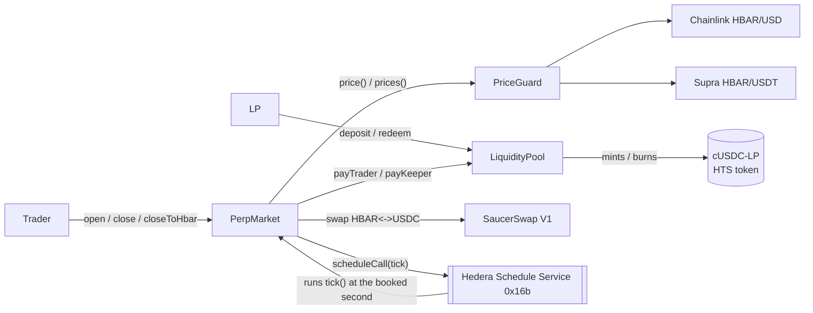
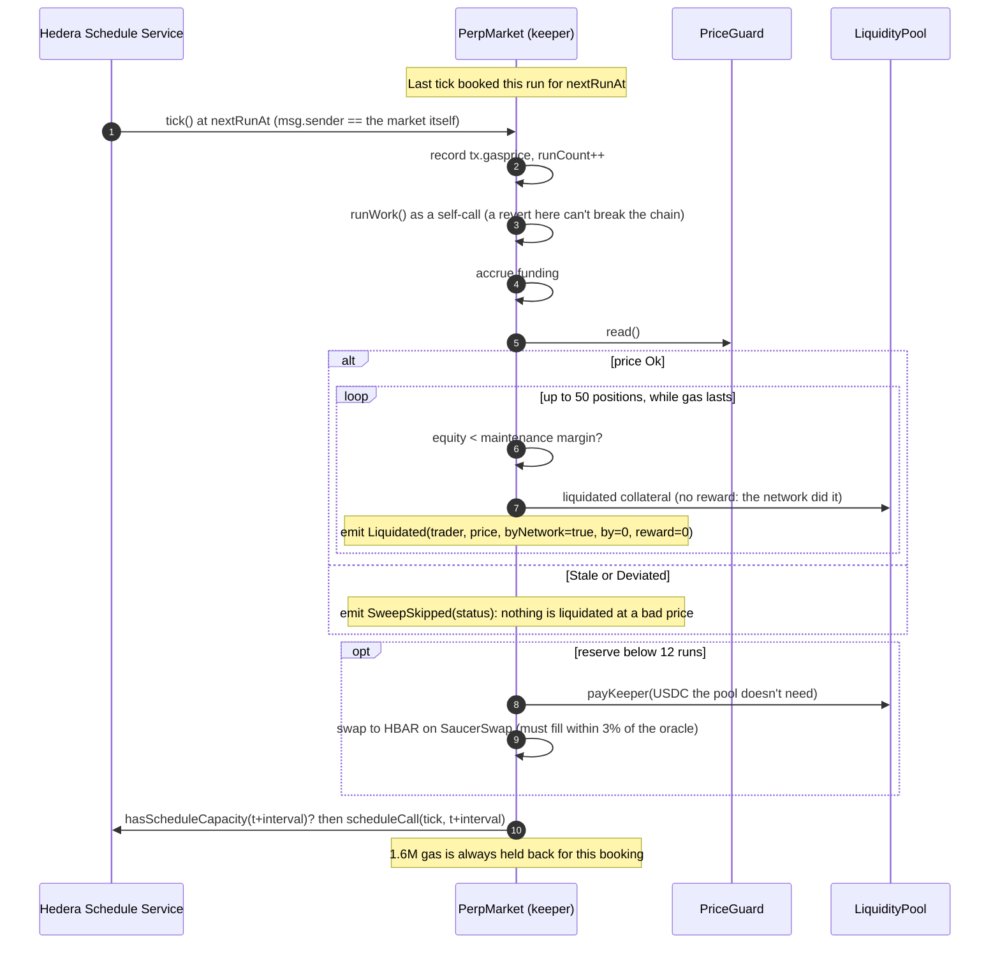

# Custos contracts: notes for the README and AGENTS.md

Everything here was measured on Hedera testnet or proven by the test suite on 2026-10-02, unless a line says otherwise. Contract source is the source of truth; this file explains it.

## 1. What the template gives you

Three reusable parts, and one market built from them:

| Contract | Job | Reuse it for |
|---|---|---|
| `ScheduledKeeper` (abstract) | Runs `_work()` every `interval` seconds with no bot. Each `tick()` books the next one on the Hedera Schedule Service (HIP-1215) and pays for it from the contract's own HBAR. | Any job that must run on a timer: liquidations, interest, expiries, rebalancing, payouts |
| `PriceGuard` | Chainlink is the price, Supra is the cross-check. `Stale` if either feed is older than `maxStaleness`, `Deviated` if they differ by more than `maxDeviationBps`. Never reverts on a broken feed. | Anything that must refuse to act on a bad price |
| `MarginAccount` (abstract) | Position book and risk math: PnL, funding, equity, maintenance margin, liquidation price, plus running sums that value every open position in O(1). | Perps, margin, anything with leveraged positions |
| `PerpMarket` | HBAR-USD perpetual market settled in USDC. Inherits all three. The network liquidates and charges funding on every tick. | The demo; copy it for a new market |
| `LiquidityPool` | USDC in, **cUSDC-LP out: a native HTS token the pool creates and mints**. Every trader's counterparty. | Any vault whose shares should be a real Hedera token |
| `examples/Heartbeat` | The smallest keeper: counts its own beats. | Start here when you write your own keeper |

Hedera services in play: Schedule Service (the keeper), Token Service (USDC collateral, plus the LP share token created and minted by a contract), Solidity on Hedera, the mirror node (the app's history), SaucerSwap V1 (open with HBAR, close to HBAR, keeper refuel), Chainlink + Supra (prices).

## 2. Architecture



- **Collateral sits in the market; the pool backs every position.** On close the market pays the collateral back and the pool covers any profit above it, or keeps any loss. On liquidation the collateral goes to the pool (minus a 0.5% reward if a person liquidated; 0 if the network did).
- **The pool is priced at what it's really worth:** its USDC minus what traders are up on open positions (or plus what they're down). Without this, anyone could deposit just before a loss lands in the pool and withdraw just after.
- **Open interest is capped at 50% of the pool**, and LPs can't withdraw below twice the open interest, so the pool can always pay every position's largest possible gain (each gain is capped at the position's entry notional).

### A liquidation, end to end



## 3. Units and numbers

| | Unit | Note |
|---|---|---|
| Position size | HBAR, 1e18, + long / − short | for another market it's that asset's units |
| Price | USD per HBAR, 1e18 | Chainlink 8 dp and Supra 18 dp are scaled to 1e18 |
| Money | USDC, 6 dp | `size × price / 1e30` = USDC |
| HBAR inside the EVM | tinybars (1 HBAR = 1e8) | `msg.value`, balances, `tx.gasprice` |

| Constant | Value |
|---|---|
| Max leverage | 50x |
| Maintenance margin | 1% of notional |
| Open / close fee | 0.1% of notional each, to the pool |
| Manual liquidation reward | 0.5% of notional (network liquidations pay none) |
| Min hold before close | 300 s |
| Open interest cap | 50% of pool USDC |
| Funding | 0.1%/h × (long − short skew) / pool assets, heavy side pays, net to the pool |
| Sweep | 50 positions per tick, stops early under 150k gas left, resumes next tick |
| Min collateral (testnet deploy) | 1 USDC |
| Keeper (testnet deploy) | interval 1,800 s, gas limit 3,000,000, starting gas price 82 tinybar/gas |
| PriceGuard (HBAR-USD) | max staleness 7,200 s, max deviation 500 bps; owner can't set staleness > 1 day or deviation > 2,000 bps |
| Refuel | when < 12 runs left, back up to 48, at most 50 USDC per refuel, only from USDC no position needs, must fill within 3% of the oracle price |

## 4. HIP-1215 and Hedera, learned the hard way

Each item was hit or measured on testnet, and each one is handled in the code.

1. **A scheduled call runs as the contract itself.** When the Schedule Service executes a call the contract booked, `msg.sender` **and** `tx.origin` are the contract's own address. Probed with a throwaway contract (`0xd603925b9c9F91ce5D4b48C55834a46730a6143b`). So `tick()` accepts only `msg.sender == address(this)`. Nobody can tick early, starve it of gas, or make the booked run revert, and `Liquidated.byNetwork` is exact. (The mirror node's `from` for a scheduled run shows the JSON-RPC relay's operator account, not the contract. Don't rely on it.)
2. **Hedera holds the whole gas limit up front.** A scheduled run only starts if the payer holds `gasLimit × gasPrice`. Proven: a 5,000,000-gas call on a contract holding 3.6 ℏ failed with `INSUFFICIENT_PAYER_BALANCE` (it needed 5M × 82 = 4.1 ℏ), even though the run itself would have cost far less. **The failed attempt still cost 0.018 ℏ.** The first Custos deploy broke this way: 5.02 ℏ in the reserve, a 6M-gas run at 85 tinybar needing 5.10 ℏ, and a `runsLeft()` that still said 3. Now `runCostEstimate()` = `gasLimit × gasPrice`, `runsLeft()` counts full holds, `canPayNextRun()` says whether the next run can start, and the default gas limit dropped from 6M to 3M.
3. **`tx.gasprice` inside a scheduled run is the network gas price in tinybars: 82** (testnet, 2026-10-02). Every tick records it, so the run-cost estimate follows the real price. Values above 1,000,000 are ignored as nonsense.
4. **Booking a schedule costs about 1.41M gas**, whatever gas limit it books (measured with 300k and 1M limits; an 800k total fails). The keeper holds back 1.6M gas from `_work()` so booking the next tick always fits, and rejects gas limits at or below that.
5. **`block.timestamp` is the start of Hedera's ~2 s block.** A schedule that fired at its exact second ran in a block that started a second earlier, so the first version reverted `TooEarly`. `tick()` accepts up to 5 s early.
6. **Capacity is per second.** `hasScheduleCapacity` is checked first; if the second is full the keeper tries the next one, up to 10 seconds. If all 10 are full or the booking fails, `nextRunAt` still moves forward and anyone can call `revive()` once the tick is `2 × interval` overdue.
7. **A failed run breaks the chain silently**, because nothing books the next one. Hence `revive()` (public, only when overdue), a self-call around `_work()` so a revert there still books the next tick, and `canPayNextRun()` for the app to warn early.
8. **SaucerSwap testnet's USDC pool is ~22x off the oracle.** 1 HBAR buys 2.249 USDC there; Chainlink says $0.1025. A keeper that refuels at that pool overpays ~22x out of LP money. On an earlier deploy with a wide band this drained the LPs to a share price of 0.40. The keeper's refuel must now fill within 3% of the oracle price, so **on testnet refuels fail closed** (the tick still sweeps and reschedules; not one micro-USDC leaves the pool) and the reserve is topped up with `fund()`. On mainnet, where SaucerSwap tracks the market, refuels go through.
9. **Supra's testnet feeds update at very different speeds.** HBAR/USDT (pair 75) pushes every few minutes to about hourly, and quotes USDT, so it can sit ~3% from Chainlink's HBAR/USD for a while: staleness is 2 h and deviation 5% for HBAR-USD. ETH/USDT (pair 19) was seen **8 h** old (2026-10-03), so a testnet ETH market needs the guard's maximum 1-day window (use about 1 h on mainnet). Pairs 0 and 1 haven't updated in months; don't use them.
10. **Creating an HTS token from a contract costs about 12 ℏ** (12.14 ℏ measured, fee plus gas). `createShareToken()` takes it as `msg.value` and sends back what's left.
11. **An account must be associated with an HTS token before it can receive it.** The pool associates itself with USDC (`associate()`); users associate with USDC and with cUSDC-LP through each token's HIP-719 `associate()`. To redeem, a user approves the pool on cUSDC-LP; the pool then pulls and burns the shares.
12. **`forge script` can't deploy through the Hedera JSON-RPC relay** (the relay rejects the EIP-1898 block parameter Foundry sends when forking), and can't simulate HSS/HTS. `yarn custos:deploy:testnet` uses `forge create` and `cast send`.
13. **The 24 KB contract size limit applies.** PerpMarket was 26.7 KB unoptimized and the relay rejected it as `CONTRACT_EXECUTION_EXCEPTION`. The optimizer (200 runs) brings it to 17.4 KB.

## 5. What a tick costs

| | |
|---|---|
| Gas limit per tick (testnet deploy) | 3,000,000 |
| Gas price | 82 tinybar/gas (measured inside a scheduled run) |
| **Held up front per run** | **2.46 ℏ**: the reserve must hold at least this or Hedera won't start the run |
| **Charged per run** | **Gas used × gas price**, not the limit. First tick of the final deploy: 1,618,265 gas used of 3,000,000, charged **1.359 ℏ** at 84 tinybar/gas (swept 2 positions, accrued funding, booked the next tick). On the previous deploy a tick that liquidated a position used 1.61M gas and was charged 1.755 ℏ at ~109 tinybar/gas. |
| Failed start (reserve too low) | 0.018 ℏ, and the chain stops until `fund()` + `revive()` |
| Per day at a 30 min interval | 48 runs × ~1.36 ℏ ≈ 65 ℏ charged |
| Testnet reserve at deploy | 36 ℏ: `runsLeft()` says 14 (each counted at the full 2.46 ℏ hold); at ~1.36 ℏ actually charged it lasts ~25 runs, ~12 h |

So the gas limit decides how much HBAR must sit in the reserve, and the work actually done decides what each run costs. To run longer: fund more (`fund()` on the market, or send HBAR to it), or lengthen the interval. Lowering the gas limit shrinks the hold but not the charge (it must stay above 1.6M, and each extra position checked costs about 20–30k gas).

## 6. Testnet deployment (final, 2026-10-02)

| | Hedera ID | EVM address |
|---|---|---|
| PerpMarket (keeper) | 0.0.10833087 | `0xb79Cc40A4b1d3C135f71Ed6dc4e9a231cC369b67` |
| LiquidityPool | 0.0.10833082 | `0x06061a60D2f9E99410F1D2b310DCF51A1ff2A3b1` |
| PriceGuard | 0.0.10833074 | `0x293e90142cc9dDF603d9Ab405B43236e8077EF75` |
| cUSDC-LP (HTS, created by the pool) | 0.0.10833090 | `0x0000000000000000000000000000000000a54cc2` |
| USDC (SaucerSwap testnet's) | 0.0.5449 | `0x0000000000000000000000000000000000001549` |

Proof transactions are listed in [`TESTNET.md`](TESTNET.md).

## 7. Error codes and what to do

| Error (selector) | Means | Fix |
|---|---|---|
| `ScheduledKeeper__OnlyNetwork` (0xe3093212) | Someone other than the Schedule Service called `tick()` | Nothing to fix: only the network ticks. To restart a stopped chain use `revive()` |
| `ScheduledKeeper__TooEarly(nextRunAt)` (0x6f69966d) | A tick arrived more than 5 s before `nextRunAt`, or no tick is booked (`nextRunAt` 0) | Wait; if `nextRunAt` is 0, call `revive()` |
| `ScheduledKeeper__NotOverdue(overdueAt)` (0x0681ef5d) | `revive()` while the chain is still healthy | Revive only after `overdueAt` = `nextRunAt + 2 × interval` |
| `ScheduledKeeper__InvalidConfig` (0xc13e0c4e) | Interval 0, gas limit ≤ 1.6M, or gas price > 1,000,000 | Use a gas limit above 1,600,000 |
| `ScheduledKeeper__Reentrant` / `OnlySelf` | Internal guards | Don't call `runWork()` or re-enter `tick()`/`revive()` from `_work()` |
| Scheduled run fails `INSUFFICIENT_PAYER_BALANCE` (Hedera) | The reserve can't cover `gasLimit × gasPrice` | `fund()` the market (check `canPayNextRun()`), then `revive()` once overdue |
| `PriceGuard__NotOk(status)` (0x9bf2faf0) | Price is `Stale` (1) or `Deviated` (2): opens, manual liquidations and refuels refuse it | Wait for the feeds; check `read()` for which feed is old or how far apart they are |
| `PriceGuard__InvalidConfig` (0x9625e495) | Zero feed address, Chainlink decimals > 18, staleness 0 or > 1 day, deviation 0 or > 2,000 bps | Fix the market's config |
| `PerpMarket__BelowMinCollateral(min)` (0x3fe7dc18) | Collateral (or what `openWithHbar`'s swap returned) is under `minCollateral` | Put up more; 1 USDC on the testnet deploy (~0.45 ℏ at SaucerSwap testnet's rate) |
| `PerpMarket__InvalidLeverage` (0xca94e446) | Leverage 0 or > 50, or the open fee would eat the collateral | Use 1–50 |
| `PerpMarket__OpenInterestCap(cap)` (0xf5de5219) | The pool can't back a position this big | Smaller size, or more pool liquidity |
| `PerpMarket__PositionExists` / `NoPosition` | One position per account | Close first / open first |
| `PerpMarket__HoldTime(closeableAt)` (0x52765821) | Closing within 300 s of opening | Wait until `closeableAt` |
| `PerpMarket__NoPrice` (0x5cda1032) | Neither feed answers, so there's no price to close at | Wait for a feed |
| `PerpMarket__NotLiquidatable` (0x2103964c) | The position isn't underwater at the current price | — |
| `PerpMarket__SwapDisabled` (0x0002a87d) | Deployed without a SaucerSwap router | Use `open` / `close` with USDC |
| `PerpMarket__OnlyKeeper` (0xeee4b657) | `refuel()` called by someone else | Only the keeper's tick refuels |
| `PerpMarket__ReserveNotLow` / `NothingToSpend` | Refuel not needed / the pool has no free USDC | — |
| `"slippage"` (SaucerSwap) | The swap would return less than your minimum (or, for refuel, less than 97% of the oracle price) | Re-quote with `quoteHbarToUsdc` / `quoteUsdcToHbar`; on testnet refuels fail this way by design (§4.8) |
| `LiquidityPool__NoPrice` (0x40c172d5) | Deposits and withdrawals pause while positions are open and the price isn't Ok | Wait for the feeds |
| `LiquidityPool__ExceedsMax(max)` (0x139fca36) | More than you hold, or more than the pool can release (it keeps 2 × open interest) | Use `maxRedeem` / `maxWithdraw` |
| `LiquidityPool__TooFewShares(shares)` (0x8811e726) | First deposit must exceed the 1,000 dead shares (0.001 USDC) | Deposit more |
| `LiquidityPool__NoShareToken` / `ShareTokenExists` | `createShareToken()` not called yet / already called | Run `yarn custos:deploy:testnet` (it creates it) |
| `LiquidityPool__HtsFailed(rc)` (0x0c9ebca3) | The Token Service refused a mint/burn/transfer; `rc` is the Hedera response code | Usually the receiver isn't associated with cUSDC-LP (rc 184 `TOKEN_NOT_ASSOCIATED_TO_ACCOUNT`): call `associate()` on the share token |
| `LiquidityPool__OnlyMarket` / `ExceedsFreeAssets` | Only the market draws on the pool, and only from USDC no position needs | — |

## 8. Honest limits

- **Testnet refuels fail closed.** SaucerSwap testnet's USDC pool is ~22x off the oracle (§4.8), so the keeper is funded by hand on testnet. Self-refuel is proven by tests at sane prices.
- **The keeper costs real HBAR.** About 1.4 ℏ per run, ~65 ℏ a day at a 30 min interval (§5). When the reserve can't cover the next run's gas hold, the chain stops until someone funds and revives it.
- **Push oracles lag.** Chainlink and Supra update on deviation or heartbeat, so the market trades on a price that can be minutes old; with 2 h staleness and a 5% deviation band, a 50x position can be hit by oracle lag. The 300 s minimum hold and the 0.1% fees blunt it; they don't remove it.
- **Liquidation keeps the remainder.** A liquidated position's leftover equity (up to 1% of notional) goes to the pool, not back to the trader.
- **The pool's value ignores the per-position gain cap and loss floor.** Exact until a position is past +100% or below zero equity; liquidation keeps positions away from the floor.
- **LPs are locked while prices are bad.** Deposits and withdrawals pause while positions are open and the price isn't `Ok`, so shares are never priced at a bad price.
- **One position per account, one market per deployment.** More markets are more deployments from `markets.json` (recipe below); the app shows the default market.
- **Funding is linear and simple** (skew / pool assets); there's no price impact and no borrow fee.
- **The keeper's HBAR can't be withdrawn.** It can only pay for network runs. Redeploying leaves the old reserve behind.
- **The owner can tune, not take.** PerpMarket's owner can only correct the gas-price estimate; PriceGuard's owner can only change staleness/deviation within hard bounds; the pool's owner links the market and creates the share token once each. No one can move user funds.
- **Testnet assets.** USDC 0.0.5449 is SaucerSwap's testnet token.

## 9. Recipes (for AGENTS.md)

### Add a market (e.g. ETH-USD)

The engine doesn't care what asset it prices: a market is a `PriceGuard` config plus a pool and a market.

1. Add an entry to `packages/foundry/markets.json`:
   ```json
   "ETH-USD": {
     "chainlink": "0xb9d461e0b962aF219866aDfA7DD19C52bB9871b9",
     "supra": "0x6Cd59830AAD978446e6cc7f6cc173aF7656Fb917",
     "supraPair": 19,
     "maxStaleness": 86400,
     "maxDeviationBps": 500,
     "refPrice8": 270000000000
   }
   ```
   (Chainlink ETH/USD on Hedera testnet, 8 dp; Supra ETH/USDT is pair 19. Supra's testnet ETH feed goes 8+ h between updates, so testnet needs the 1-day maximum; use about 3,600 on mainnet.)
2. `yarn foundry:test`: `test/Markets.t.sol` runs open, close, network liquidation and pool accounting for **every** market in `markets.json` at its `refPrice8`.
3. Check the config offline, `yarn workspace @sh/foundry check-markets ETH-USD`, then the feeds on testnet, `yarn custos:check-market:testnet --market ETH-USD`: it deploys only a PriceGuard and reads both feeds, and exits 1 if either doesn't answer. (Run on 2026-10-03: Chainlink 2,657.85, Supra 2,702.77, both answering; PriceGuard `0x1eD9de819a144d7b6C80102Ff5FA83180151949D`.)
4. Deploy it: `yarn workspace @sh/foundry custos deploy --market ETH-USD`, then `start` and `demo` with the same flag. Its addresses go to `deployments/296-eth-usd.json`; the app keeps showing HBAR-USD.

### Reuse the engine for lending

Keep `ScheduledKeeper` and `PriceGuard`; write the loan book.

```solidity
contract LendingMarket is ScheduledKeeper {
    PriceGuard public immutable guard;
    mapping(address => Loan) internal loans;
    address[] internal borrowers;

    constructor(PriceGuard guard_) ScheduledKeeper(3600, 3_000_000, 82) { guard = guard_; }

    function _work() internal override {
        (uint256 price, PriceGuard.Status status,,,) = guard.read();
        _accrueInterest();                        // the network charges interest every hour
        if (status != PriceGuard.Status.Ok) return; // never liquidate at a bad price
        // page through `borrowers` like PerpMarket._sweep, liquidating loans under their health factor
    }
}
```

Copy `PerpMarket._sweep` for paging (a cursor plus a gas floor so a big book spreads over several ticks), and copy how `LiquidityPool` creates an HTS share token if lenders should hold a real token.

### Add a keeper job

Override `_work()` in any `ScheduledKeeper`. `examples/Heartbeat.sol` is the minimal version:

```solidity
contract MyJob is ScheduledKeeper {
    constructor() ScheduledKeeper(600, 2_000_000, 82) {} // every 10 min, 2M gas, 82 tinybar/gas to start
    function _work() internal override { /* the job: a revert here is caught, the next tick is still booked */ }
    function _keepGoing() internal view override returns (bool) { return true; } // false ends the chain
}
```

Deploy it, send it HBAR (`fund()`), call `revive()` once to book the first tick. Keep `_work()` under `gasLimit − 1,600,000` gas. To add work to the perp market itself, extend `PerpMarket._work()`; it already accrues funding, sweeps and refuels.

### Change the interval

The interval is fixed at deploy (`immutable`): `KEEPER_INTERVAL=3600 yarn custos:deploy:testnet`. Things to weigh:
- **Cost:** each run is charged for the gas it uses (~1.36 ℏ for a tick that books the next one and sweeps a small book), so halving the interval roughly doubles the HBAR spent (§5).
- **Safety:** at 50x a ~2% move wipes a position. The sweep checks 50 positions per tick, so a slower interval means underwater positions wait longer and the pool takes the slack (manual liquidators can still act any time, for the 0.5% reward).
- **Funding** accrues continuously; the interval only decides when it's booked.

## 10. Tests

`yarn foundry:test` runs 213 tests, all passing:

| Suite | Tests | What it covers |
|---|---|---|
| `PerpMarket.t.sol` | 60 | Trading, network keeper, funding, SaucerSwap paths, audit regressions, gas-hold accounting |
| `PerpMarket.fuzz.t.sol` | 25 | USDC conservation on open → move → close, gain cap, liquidation splits, close-price selection, `closeToHbar`, OI cap, random books |
| `LiquidityPool.t.sol` | 30 | HTS share token, deposit/redeem/withdraw, pool value with open PnL, JIT attacks, inflation attack, access |
| `ScheduledKeeper.t.sol` + `.edge.t.sol` | 41 | Network-only tick, tolerance window, capacity probing, failure codes, revive boundaries, gas starvation, reentrancy, Heartbeat |
| `PriceGuard.t.sol` + `.fuzz.t.sol` | 34 | Decimals scaling, staleness and deviation boundaries, broken and overflowing feeds, owner bounds |
| `MarginMath.t.sol` | 20 | PnL, equity cap, liquidation price, funding index, running sums vs per-position sums |
| `Markets.t.sol` | 2 | Every market in `markets.json` through a full cycle: open long and short at its reference price, network liquidation, profitable close, empty balanced books |
| `invariant/Solvency.t.sol` | 10 invariants × 256 runs × 50 calls | Pool covers max gains; no bad debt; reserve covers the next tick; running sums match positions; collateral and OI books match; shares backed; nothing underwater after a tick; keeper stays scheduled |

An independent audit (2026-10-02) found one High (JIT deposit/redeem around losses and liquidations), three Medium (early/gas-starved manual ticks, dust positions, closes at a stale price) and two Low (funding measured after a deposit, refuel slippage from a same-transaction quote). All are fixed, each with a regression test that replays the attack. Fuzzing then found a PriceGuard revert on overflowing feed values, also fixed.

### Lint

`forge lint` reports 0 warnings. The rules excluded in `foundry.toml` are listed there with a one-line reason each (timestamp use is the keeper's job; every state-changing entry point is `nonReentrant`; casts are of bounded values; the keeper's HBAR is deliberately non-withdrawable).
